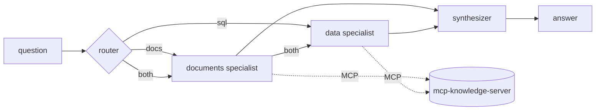

# agent-graph-lab

The same 20 questions, answered three ways, on the same tools and the same eval:

| variant | what it is |
|---|---|
| `loop` | one agent, a tool loop I wrote by hand |
| `graph` | the same agent, prompt and limits, but the loop is a [LangGraph](https://github.com/langchain-ai/langgraph) graph |
| `multi` | a LangGraph team: a router, a documents specialist, a data specialist and a synthesizer |

The tools are not written here. They come from my [mcp-knowledge-server](https://github.com/ihkuzu/mcp-knowledge-server) over MCP (stdio subprocess): `search_docs`, `read_doc`, `list_docs`, `list_tables`, `describe_table` and `run_sql` for a fictional online shop (10 policy documents, a SQLite database with customers, products and orders).

The point is the comparison. A framework or a team of agents should earn its extra model calls, so the eval counts correctness, tool use, steps, model calls and latency per variant instead of assuming that more structure is better.

## Architecture



`loop` and `graph` use one agent with all six tools. In `multi` each specialist only sees its own tools (documents or database) and its own prompt, and runs the same bounded tool loop. The synthesizer sees the question and the specialists' notes, nothing else.

All three share the code in `core.py`: one `decide` step (ask the model, parse the JSON action) and one `act` step (call the tool). `loop` calls them in a `while`, `graph` wires them as two nodes with a conditional edge. So any difference between those two is orchestration overhead, not a different prompt.

Rules every loop enforces, because small models need them:

- one JSON object per reply: `{"tool": ..., "args": ...}` or `{"final": ...}`; invalid replies are reported back as an observation
- a step limit per loop
- an identical repeated tool call is refused
- a final answer before a successful tool call is refused (the model has to look at the sources first)
- a tool outside the role's tool set is refused

The MCP client is async, the model clients and graph nodes are sync, so `Toolbox` runs the client in one task on a background event loop and exposes a plain blocking `call`.

## The eval

`data/eval/questions.json` has 20 questions in four groups:

| group | count | needs | example |
|---|---|---|---|
| docs | 6 | documents | "From which order value is shipping free?" |
| sql | 6 | database | "How many customers live in Munich?" |
| hybrid | 5 | both | "What is our total revenue according to the company's definition of revenue?" |
| unanswerable | 3 | documents (to find out there is nothing) | "What is the company's parental leave policy?" |

- **correct**: the answer contains the expected facts. SQL gold values are computed by running a reference query on the database, not typed in. For unanswerable questions the answer has to say the documents do not cover it.
- **tools ok**: every source the question needs was used successfully at least once.
- **steps / LLM calls / seconds**: average per question.

The check is substring and number matching, so a correct answer in unusual words can be marked wrong. That is the same trade-off as in my [sql-agent](https://github.com/ihkuzu/sql-agent).

## Results

Model: `llama3.2:3b` through Ollama, 20 questions, answers scored by the rules above. Run on my own PC; the full per-question answers and tool traces are in `results/`.

| variant | correct (run 1) | correct (same code, run 2) | tools ok | model calls per question | seconds per question |
|---|---|---|---|---|---|
| `loop` | 11/20 | 11/20 | 14/20 | 4.35 | 1.35 |
| `graph` | 10/20 | 11/20 | 13/20 | 4.4 | 1.41 |
| `multi` | 12/20 | 12/20 | 16/20 | 7.65 | 2.62 |

Correct answers per group (run 1):

| variant | docs (6) | sql (6) | hybrid (5) | unanswerable (3) |
|---|---|---|---|---|
| `loop` | 6 | 1 | 1 | 3 |
| `graph` | 5 | 1 | 1 | 3 |
| `multi` | 5 | 3 | 1 | 3 |

What I take from it:

- **The framework changed nothing.** `loop` and `graph` share all logic and land within one question of each other, the same spread as between two runs of identical code.
- **The team costs about 1.8x the model calls and time and gains one or two questions**, which is inside the noise of a 20-question set. I would not say it is better.
- **Where it does help is tool choice.** With six tools the single agent often looked for customer counts in the documents (tools ok only 13 to 14 of 20, SQL questions 1 of 6). The data specialist sees only SQL tools and gets 3 of 6.
- **A 3B model is weak at SQL here either way.** It writes `?` placeholders, calls `describe_table` again and again and runs out of steps. No variant gets more than 1 of 5 hybrid questions.
- **Prompt rules did not fix it.** In a second round I added rules to the SQL prompts (no `?` placeholders, the schema is complete, use `run_sql` for counts and prices). It fixed some SQL questions, but the model then tried SQL on document questions: 9, 9 and 10 of 20 (`results/round2_prompt_rules.json`). I reverted the change. These rules were written after reading the failures on these same questions, so even a gain would not have been a clean result.

Scoring note: after the first run I found that my check for unanswerable questions did not recognise phrases like "not documented". I fixed the phrase list and re-scored the saved answers (`agentlab rescore`) without calling the model again. Before that fix the numbers were 10, 9 and 10. The correct answers per question are unchanged.

To repeat the measurement:

```bash
agentlab eval --llm ollama --model llama3.2:3b --out results.json
```

## Run it

```bash
pip install -e ".[dev]"
agentlab init-db                  # sample shop database in data/shop.db
agentlab ask "How many customers live in Munich?" --variant multi
agentlab eval --variants loop,graph,multi --out results.json
agentlab rescore results.json    # score saved answers again, no model needed
```

Models: Ollama (default, `llama3.2:3b`) or Gemini (`--llm gemini`, needs `GEMINI_API_KEY`). Replies are requested as JSON.

Tests need no model and no network. They script the model's replies and run against the real MCP server over stdio:

```bash
pytest -q
```

## Limits

- Documents and data are fictional and small (10 documents, 18 products, 400 orders). The numbers say something about these agents on this task, not about agents in general.
- 20 questions are enough to see big differences and not enough to rank two close variants. Two runs of the same code differed by one question.
- A 3B model through Ollama is weak at following the JSON protocol. That is on purpose (it shows what the guard rails catch), but it also means failures can be the model and not the architecture. The Gemini option exists to check that.
- The synthesizer can only be as good as the specialists' notes; it has no tools to check them.
- No memory between questions, no streaming, no parallel specialists.

## Layout

```
src/agentlab/
  core.py        decide/act steps, limits, parser, schema from MCP
  agents.py      LoopAgent, GraphAgent, MultiAgent
  prompts.py     system prompts per role
  toolbox.py     sync wrapper around the async MCP client
  evaluation.py  cases, correctness, tool-use check, report
  llm.py         Ollama, Gemini and a scripted model for tests
  cli.py
data/docs        the documents served by the MCP server
data/eval        the questions
results/         answers and tool traces of the measured runs
tests/           36 tests, no model needed
```

MIT license.
